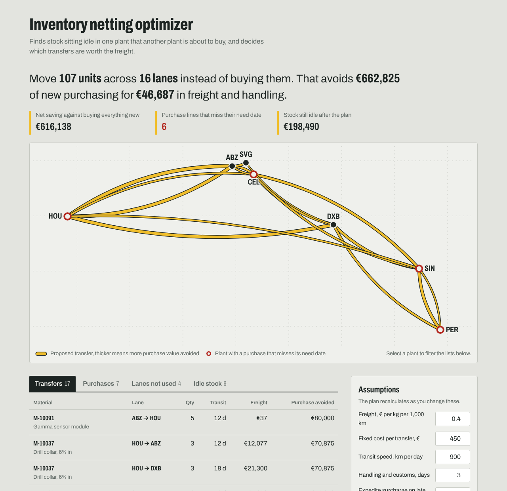

# Inventory netting optimizer

**Live demo:** https://awaisq5.github.io/inventory-netting-optimizer/

Global companies regularly buy spare parts for one plant while the same parts sit idle in another. This tool finds those cases and decides, part by part, whether moving stock between plants is cheaper than buying new, taking freight, handling cost and delivery dates into account.



## Why I built it

During a rotational supply chain leadership program I worked on a global inventory netting and reallocation initiative, which identified up to $2M in savings. The analysis back then lived in spreadsheets: export stock (MB52) and requirements (MD04) from SAP, match excess against shortages, check lanes by hand. This project turns that process into a repeatable tool, and replaces "nearest plant first" with an actual optimization.

## What it does

1. **Nets stock against demand** for every material and plant. Safety stock and local requirements are protected first. What's left over is *excess*; what's missing is *shortage*.
2. **Builds candidate lanes** between plants with excess and plants with shortage. Freight is calculated from weight and great-circle distance. Lanes that can't arrive before the need date are excluded and reported as *too slow*.
3. **Solves a cost-optimal plan** per material: transfer, or buy new (with an expedite surcharge if the supplier lead time misses the need date).
4. **Explains itself:** which lanes were rejected and why ("Moving 10 units would save €378, less than the €450 cost of raising a transfer"), which purchases will be late, and how much stock remains idle afterwards.
5. **Exports** the transfer list as CSV, ready to become stock transport orders.

Everything runs in the browser. No data leaves the machine, which matters when the input is a company's inventory.

## The model

Each material is solved as a **fixed-charge transportation problem**, a mixed-integer program:

```
minimise   Σ freightᵢⱼ · xᵢⱼ  +  F · yᵢⱼ  +  Σ buyCostⱼ · bⱼ

subject to Σⱼ xᵢⱼ ≤ excessᵢ                  every source ships at most its excess
           Σᵢ xᵢⱼ + bⱼ = shortageⱼ           every shortage is covered, by transfer or purchase
           xᵢⱼ ≤ Mᵢⱼ · yᵢⱼ                   a lane costs F once it carries anything
           xᵢⱼ, bⱼ ∈ ℤ≥0,  yᵢⱼ ∈ {0, 1}
```

The fixed charge `F` is what makes this realistic: a stock transfer has paperwork, customs and handling costs regardless of quantity, so moving two cheap O-ring kits across a continent is not worth it even when the freight is negligible. A plain linear program would happily recommend it.

Solving per material keeps each model small (a few dozen variables), so the full plan solves instantly in the browser using [javascript-lp-solver](https://github.com/JWally/jsLPSolver)'s branch-and-cut.

## Using your own data

Upload four CSV files. Download any table in the app to get a template with the expected columns.

| File | SAP source | Columns |
|---|---|---|
| `plants.csv` | Plant list | `plant, name, country, lat, lon` |
| `materials.csv` | Material master (MM03) | `material, description, unit_price_eur, unit_weight_kg, lead_time_days` |
| `stock.csv` | Stock overview (MB52) | `material, plant, unrestricted, safety_stock` |
| `demand.csv` | Stock/requirements list (MD04) | `material, plant, quantity, need_by_days` |

The bundled sample is **synthetic**: a spare-parts network for drilling tools across seven plants. Material numbers, prices and quantities are invented.

## Running locally

```bash
npm install
npm run dev      # http://localhost:5173
npm test         # unit tests for the netting logic, solver and CSV parsing
npm run build
```

## Project structure

```
src/domain/positions.ts   netting of stock vs. demand per material and plant
src/domain/optimize.ts    lane building, the MIP model, greedy baseline, plan totals
src/domain/csv.ts         CSV parsing with row-level validation errors
src/components/           network drawing
src/App.tsx               the page
```

## Limitations and next steps

- Freight uses one blended rate and speed. A real version would read lane-specific rates and modes (road, ocean, air) from the freight forwarder's tariff.
- Customs restrictions and dangerous goods rules (for example lithium batteries) are not modelled.
- Need dates are aggregated to the earliest requirement per plant. Splitting by requirement date would let urgent and non-urgent demand take different lanes.
- Next step: read stock and requirements directly from SAP via OData instead of CSV exports.

## License

MIT
